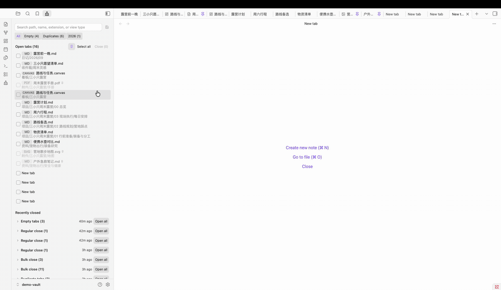

# Tab Cleaner for Obsidian

[English](README.md) | [简体中文](README.zh-CN.md)

Visually find, review, and safely close groups of Obsidian tabs.

## Features

- Visual list of tabs in the main workspace
- Built-in Empty and Duplicates search groups that can be unpinned
- Search by path, file name, extension, or view type
- Reusable search groups that can be pinned, edited, or removed
- Quick toggles for pinned-tab and active-tab protection in the cleaner panel
- Active-tab protection by default
- Recently closed cleanup batches with one-click reopening
- Simplified Chinese and English interfaces based on the Obsidian language
- Safe closing boundary: only empty tabs and file-backed tabs can be selected

## Install

In Obsidian, open **Settings → Community plugins → Browse**, search for **Tab Cleaner**, then install and enable it.

Requires Obsidian 1.8.7 or later. Designed for desktop and mobile, tested on macOS. The interface follows Obsidian’s language (English or Simplified Chinese).

BRAT and manual installation

- **BRAT** — In BRAT settings, choose **Add Beta plugin** and enter `https://github.com/caijyii/obsidian-tab-cleaner`. [Get BRAT](https://github.com/TfTHacker/obsidian42-brat)
- **Manual** — Copy `main.js`, `manifest.json`, and `styles.css` from the same release into `.obsidian/plugins/tab-cleaner/` inside your vault. Reload Obsidian and enable Tab Cleaner. [GitHub Releases](https://github.com/caijyii/obsidian-tab-cleaner/releases)

Release files from 1.1.4 onward have GitHub build attestations. To verify a file, run `gh attestation verify main.js --repo caijyii/obsidian-tab-cleaner`, substituting the file name as needed.

## Usage

1. Click the brush icon in the ribbon or run **Tab Cleaner: Open panel** from the command palette.
2. Choose **Empty**, **Duplicates**, or a saved group, or type a search. Click a tab’s name to inspect it in the workspace.
3. Check the tabs you want to close and choose **Close selected**. Only empty tabs and tabs backed by files in the main workspace can be closed.

**Recently closed** groups matching tabs from the same batch into one entry. For example, closing three empty tabs produces an entry marked `×3`. Reopening it opens one new empty tab. To reopen a file, it must still be at its original path.

## Privacy

Settings and cleanup history stay in your vault. Tab Cleaner never reads or changes note contents or sends data to an external service.

 

 

[Report an issue](https://github.com/caijyii/obsidian-tab-cleaner/issues) · Inspired by [Tab Out](https://github.com/zarazhangrui/tab-out) · [MIT](LICENSE) © 2026 caijyii
