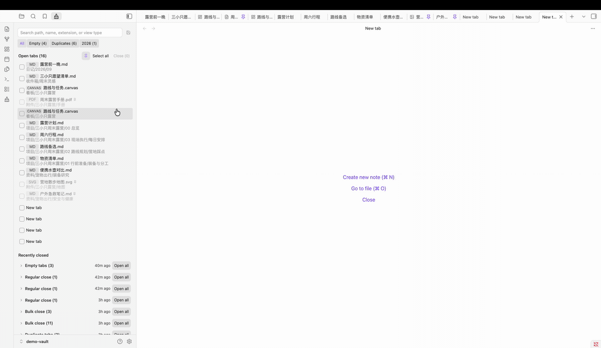

# Tab Cleaner for Obsidian

[English](README.md) | [简体中文](README.zh-CN.md)

Tab Cleaner is a visual workspace for reviewing and safely closing groups of Obsidian tabs.



## Features

- Visual list of tabs in the main workspace
- Built-in filters for empty and duplicate tabs
- Search by path, file name, extension, or view type
- Reusable search groups that can be edited or removed
- Pinned-tab protection available directly in the cleaner panel
- Active-tab protection by default
- Recently closed cleanup batches with one-click reopening
- Simplified Chinese and English interfaces based on the Obsidian language
- Safe closing boundary: only empty tabs and file-backed tabs can be selected

Empty tabs are grouped into Recently closed and can be reopened as a new empty tab. Sidebar tools and the Tab Cleaner panel itself are never included.

## Requirements

- Obsidian 1.8.7 or later
- Designed for desktop and mobile; currently tested on macOS

Back up important work and test the workflows you rely on before introducing any tab-management plugin to an important vault.

## Install

### Community Plugins

Tab Cleaner is available in the Obsidian Community Plugins directory:

1. Open **Settings → Community plugins** in Obsidian.
2. Choose **Browse** and search for **Tab Cleaner**.
3. Choose **Install**, then enable the plugin.

### BRAT

To test a GitHub release directly, install it with [BRAT](https://github.com/TfTHacker/obsidian42-brat):

1. Install and enable BRAT.
2. Choose **Add Beta plugin** in the BRAT settings.
3. Enter `https://github.com/caijyii/obsidian-tab-cleaner`.

### Manual installation

Download `main.js`, `manifest.json`, and `styles.css` from the matching [GitHub release](https://github.com/caijyii/obsidian-tab-cleaner/releases), then copy them into:

```text
YOUR_OBSIDIAN_VAULT/.obsidian/plugins/tab-cleaner/
```

Replace `YOUR_OBSIDIAN_VAULT` with the folder that contains your Obsidian notes.

Restart Obsidian or reload plugins, then enable **Tab Cleaner** under Settings → Community plugins.

## Usage

Open the ribbon brush icon or run **Tab Cleaner: Open panel** from the command palette.

1. Choose All, Empty, Duplicates, a saved search group, or enter a search.
2. Choose whether pinned tabs can be selected, then select visible tabs or adjust them individually.
3. Choose **Close selected**.
4. Reopen tabs later from **Recently closed** if needed.

Recently closed consolidates repeated instances of the same file, URL, or empty-tab type into an `×N` record. The count describes how many tabs were closed; reopening restores one tab per record.

To create a reusable search group, search for a stable path, file name, extension, or view type, then choose the save icon. Edit or delete saved groups from the pencil beside an active filter or from the plugin settings.

## Safety and privacy

- Tab Cleaner does not send data anywhere.
- It does not read or modify note contents.
- Settings and recent cleanup history stay in Obsidian's local plugin data file.
- Non-file views that cannot be safely restored are excluded from closing.
- Empty tabs are saved as an aggregated history entry and reopen as one new empty tab.

## Known limitations

- Reopening a cleanup batch restores one tab per history entry, even if `×N` indicates that several equivalent tabs were closed.
- A recently closed file cannot be reopened after the file has been deleted or moved.

## Feedback

Please report bugs and feature requests in [GitHub Issues](https://github.com/caijyii/obsidian-tab-cleaner/issues).

## Acknowledgements

The product concept was inspired by [Tab Out](https://github.com/zarazhangrui/tab-out).

## License

[MIT](LICENSE) © 2026 caijyii
