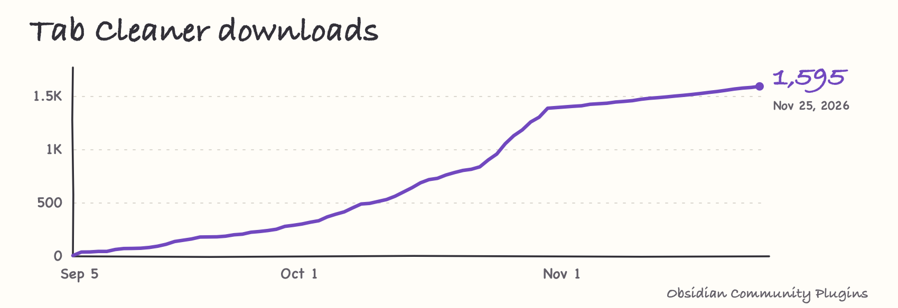

# Tab Cleaner for Obsidian

[English](README.md) | [简体中文](README.zh-CN.md)

Find empty or duplicate tabs in your workspace, review them in one list, and close the ones you select.

## Features

- Filter tabs by path, file name, extension, or view type. Save frequent searches as groups and pin them for quick access.
- Active and pinned tabs are protected by default. You can adjust both protections in the panel.
- Reopen a cleanup batch from **Recently closed**.

The [community archive maintained by yulei-chen](https://yulei-chen.github.io/obsidian-plugin-download-stats/#tab-cleaner) reconstructs this history from [Obsidian’s plugin download counts](https://github.com/obsidianmd/obsidian-releases/blob/master/community-plugin-stats.json).

## Install

In Obsidian, open **Settings → Community plugins → Browse**, search for **Tab Cleaner**, then install and enable it.

Requires Obsidian 1.8.7 or later. Designed for desktop and mobile, tested on macOS. The interface follows Obsidian’s language (English or Simplified Chinese).

BRAT and manual installation

- **BRAT** — In BRAT settings, choose **Add Beta plugin** and enter `https://github.com/caijyii/obsidian-tab-cleaner`. [Get BRAT](https://github.com/TfTHacker/obsidian42-brat)
- **Manual** — Copy `main.js`, `manifest.json`, and `styles.css` from the same release into `.obsidian/plugins/tab-cleaner/` inside your vault. Reload Obsidian and enable Tab Cleaner. [GitHub Releases](https://github.com/caijyii/obsidian-tab-cleaner/releases)

Release files from 1.1.4 onward have GitHub build attestations. To verify a file, run `gh attestation verify main.js --repo caijyii/obsidian-tab-cleaner`, substituting the file name as needed.

## Usage

1. Click the brush icon in the ribbon or run **Tab Cleaner: Open panel** from the command palette.
2. Choose **Empty**, **Duplicates**, or a saved group, or type a search. Click a tab’s name to inspect it in the workspace.
3. Check the tabs you want to close and choose **Close selected**. Only empty tabs and tabs backed by files in the main workspace can be closed.

In **Recently closed**, a count such as `×3` means three matching tabs were closed together. Reopening that entry restores one tab. Restoring a file requires it to still be at its original path.

## Privacy

Settings and cleanup history stay in your vault. Tab Cleaner never reads or changes note contents or sends data to an external service.

[Report an issue](https://github.com/caijyii/obsidian-tab-cleaner/issues) · Inspired by [Tab Out](https://github.com/zarazhangrui/tab-out) · [MIT](LICENSE) © 2026 caijyii
