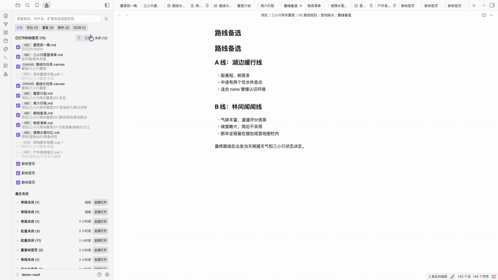

# Obsidian Tab Cleaner

[English](README.md) | [简体中文](README.zh-CN.md)

Tab Cleaner 是一款 Obsidian 可视化标签页清理插件，帮助你查看标签页，并在确认后安全地批量关闭。



## 功能

- 可视化展示主工作区中的标签页
- 内置“空白”和“重复”检索组，可取消置顶
- 按路径、文件名、扩展名或视图类型搜索
- 将搜索条件保存为可置顶、可编辑、可删除的检索组
- 可在清理面板中快捷开关固定标签页和当前标签页保护
- 默认保护当前活动标签页
- 按批次保存最近关闭记录，并支持一键重新打开
- 根据 Obsidian 应用语言自动显示简体中文或英文
- 安全关闭边界：只允许选择空白标签页和以文件为基础的标签页

空白标签页会合并写入“最近关闭”，并可重新打开为一个新的空白标签页。左右侧栏工具和 Tab Cleaner 自己的面板不会进入清理范围。

## 使用要求

- Obsidian 1.8.7 或更高版本
- 面向桌面端和移动端设计；目前仅在 macOS 上经过实测

建议备份重要内容，并在将任何标签页管理插件用于重要 Vault 前验证你常用的工作流程。

## 安装

### 通过第三方插件目录安装

Tab Cleaner 已进入 Obsidian 第三方插件目录：

1. 在 Obsidian 中打开“设置 → 第三方插件”。
2. 点击“浏览”并搜索 **Tab Cleaner**。
3. 点击“安装”，然后启用插件。

### 通过 BRAT 安装

如需直接测试 GitHub Release，可以通过 [BRAT](https://github.com/TfTHacker/obsidian42-brat) 安装：

1. 安装并启用 BRAT。
2. 在 BRAT 设置中选择 **Add Beta plugin**。
3. 输入 `https://github.com/caijyii/obsidian-tab-cleaner`。

### 手动安装

从对应的 [GitHub Release](https://github.com/caijyii/obsidian-tab-cleaner/releases) 下载 `main.js`、`manifest.json` 和 `styles.css`，然后复制到：

```text
你的 Obsidian 仓库目录/.obsidian/plugins/tab-cleaner/
```

请将“你的 Obsidian 仓库目录”替换为实际存放 Obsidian 笔记的文件夹。

重启 Obsidian 或重新加载插件，然后前往“设置 → 第三方插件”启用 **Tab Cleaner**。

## 使用方法

点击 Obsidian 左侧功能区中的清理刷图标，或者在命令面板中运行 **Tab Cleaner: 打开面板**。

1. 选择“全部”“空白”“重复”、自定义检索组，或者直接输入搜索内容。
2. 通过列表右上方的保护开关，决定是否允许选择固定标签页和当前标签页，然后选择当前可见项或逐项勾选。
3. 点击 **关闭所选**。
4. 如果需要找回标签页，可在 **最近关闭** 中重新打开。

“最近关闭”会把同一批次中相同的文件、网址或空白标签页合并为 `×N` 记录；数量表示当时关闭的标签页数量，重新打开时每条记录只恢复一个标签页。

要创建可重复使用的检索组，可以搜索稳定的路径、文件名、扩展名或视图类型，再点击保存图标。已保存的检索组可从当前筛选旁的编辑图标或插件设置页中编辑、删除。

“空白”和“重复”是内置检索组，默认置顶。可在插件设置中通过置顶开关调整内置或自定义检索组的置顶状态。开启后仅显示可执行的上移、下移按钮，用于调整置顶组的顺序；首项不显示上移，末项不显示下移，只有一个置顶组时不显示排序按钮。未置顶组按最近使用排列，包括内置检索组。宽度足够时所有组都会显示；空间不足时优先显示当前组和置顶组，其余检索组可通过“更多检索组”访问。

主页面中，置顶组使用淡主题色，“全部”与非置顶组使用相同的淡中性色底色和悬浮色，与是否内置无关。选中统一使用主题色文字、下划线和稍粗字形，保留本类浅底色，仍可辨认置顶状态。置顶组可横向拖动调整顺序，拖动不会切换当前检索组。管理弹窗也提供上移、下移按钮，可调整被收起的置顶组。已有检索组的置顶和排序即时保存；自定义组名称编辑后会在名称行显示确认图标，点击后保存名称。关闭弹窗只会丢弃尚未确认的名称。新增检索组仍需点击“保存”创建。

当前检索组的管理图标位于下方列表标题旁，鼠标悬浮或键盘聚焦时显示，触屏上始终显示。图标预留位置，显示时不会挤动标题或顶部检索组。

受保护的标签页仅禁用复选框；仍可点击名称或内容区域定位到该标签页。固定图标和当前标签页标记使用主题强调色，当前标记显示在固定图标右侧，并独立于当前标签页保护开关。

两种标签页保护快捷按钮均无底色：开启时显示主题色、无划线图标，关闭时显示灰色、带划线图标。

## 安全与隐私

- Tab Cleaner 不会向外部发送数据。
- 插件不会读取或修改笔记内容。
- 设置和最近清理记录只保存在 Obsidian 本地的插件数据文件中。
- 无法安全恢复的非文件视图不会被允许关闭。
- 空白标签页会合并为一条历史记录，重新打开时恢复为一个新的空白标签页。

## 已知限制

- 如果 `×N` 表示多个相同标签页被关闭，重新打开时每条历史记录仍只恢复一个标签页。
- 文件被删除或移动后，对应的最近关闭记录无法重新打开。

## 反馈

请通过 [GitHub Issues](https://github.com/caijyii/obsidian-tab-cleaner/issues) 报告问题或提出功能建议。

## 致谢

产品概念受到 [Tab Out](https://github.com/zarazhangrui/tab-out) 启发。

## 许可证

[MIT](LICENSE) © 2026 caijyii
