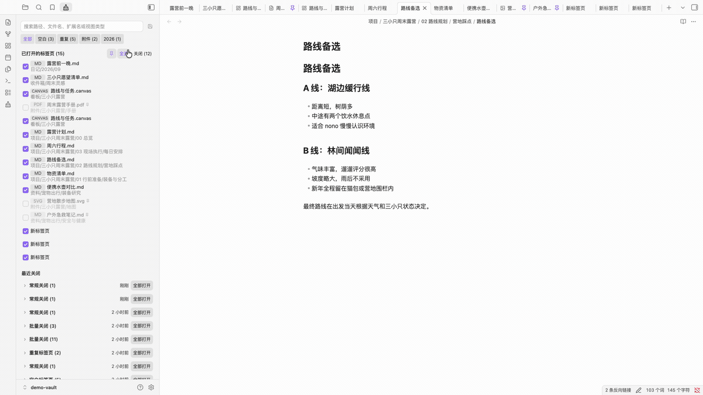
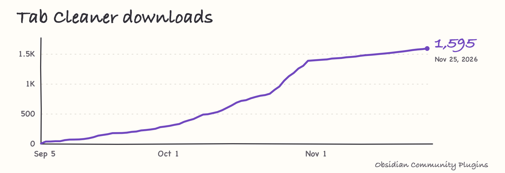

# Obsidian Tab Cleaner

[English](README.md) | [简体中文](README.zh-CN.md)

在一张列表里找出工作区中空白或重复的标签页，确认后批量关闭。

## 功能

- 按路径、文件名、扩展名或视图类型筛选标签页。常用搜索可保存为检索组并置顶。
- 默认保护当前标签页和固定标签页，两项保护都可以在面板中调整。
- 在**最近关闭**中一键重新打开同一批关闭的标签页。

## 安装

在 Obsidian 的**设置 → 第三方插件 → 浏览**中搜索 **Tab Cleaner**，安装后启用。

需要 Obsidian 1.8.7 或更高版本。面向桌面端和移动端设计，目前已在 macOS 上实测。界面随 Obsidian 语言显示简体中文或英文。

通过 BRAT 或手动安装

- **BRAT** — 在 BRAT 设置中选择 **Add Beta plugin**，输入 `https://github.com/caijyii/obsidian-tab-cleaner`。[获取 BRAT](https://github.com/TfTHacker/obsidian42-brat)
- **手动安装** — 从同一个 Release 下载 `main.js`、`manifest.json` 和 `styles.css`，放入笔记仓库的 `.obsidian/plugins/tab-cleaner/` 目录。重新加载 Obsidian 后启用插件。[GitHub Releases](https://github.com/caijyii/obsidian-tab-cleaner/releases)

从 1.1.4 版起，发布文件附有 GitHub 构建证明。运行 `gh attestation verify main.js --repo caijyii/obsidian-tab-cleaner` 即可验证，检查其他文件时替换文件名。

## 使用方法

1. 点击左侧功能区的清理刷图标，或在命令面板中运行 **Tab Cleaner: 打开面板**。
2. 选择**空白**、**重复**或已保存的检索组，也可以直接搜索。点击标签页名称可在工作区中查看对应页面。
3. 勾选要关闭的标签页，点击**关闭所选**。可关闭范围限于主工作区的空白标签页和文件标签页。

在**最近关闭**中，`×3` 表示同一批关闭了三个相同的标签页，恢复这条记录会打开一个标签页。恢复文件时，文件需要仍在原路径。

## 隐私

设置和清理记录只保存在本地笔记仓库。Tab Cleaner 不读取或修改笔记内容，也不会向外部服务发送数据。

 

 

[问题与建议](https://github.com/caijyii/obsidian-tab-cleaner/issues) · 灵感来自 [Tab Out](https://github.com/zarazhangrui/tab-out) · [MIT](LICENSE) © 2026 caijyii
